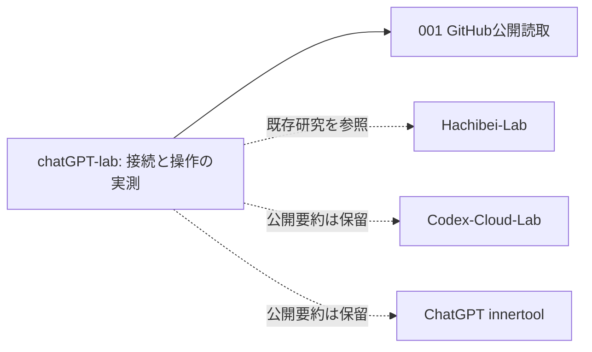

# 研究マップ

2026-11-17時点。今回の実測は[001 GitHub read](../experiments/001-github-read/RESULTS.md)だけです。「次の候補」は未実行の提案であり、実行承認ではありません。

|領域|調べたい問い|確認方法|現状|次の候補|
|---|---|---|---|---|
|モデルの性能・速度・指示追従|同じ条件で正確性・応答時間・制約遵守はどう違うか|画面上のモデル名、固定入力、採点規則、反復回数を事前登録|NOT_TESTED。今回はモデル名UNKNOWN、ツール所要時間をモデル速度と扱わない|非秘密の固定3問で採点契約を作る|
|プラグイン／接続アプリ|見える接続で何を実際に読めるか|対象・tool・戻り値・別経路を固定|001のGitHub公開読取3操作PASS。表示/読取/書込は別能力|存在しないpathへのエラー応答の負対照|
|MCPと外部AI・ツール|提供API、認可、実適用、結果の対応を識別できるか|認可済みの非秘密入力と呼出ID・応答を記録|今回外部AI・有料APIはNOT_TESTED。GitHub用ツールの成功をMCP全般へ一般化しない|候補toolのread-only仕様・権限を棚卸し|
|ファイル取得・作成・保存・再取得|保存受付と元byteの保持は一致するか|固定小ファイル、size/SHA-256、別取得経路|README 2067 bytesを別経路照合。一般ファイル保管能力はNOT_TESTED|少量の非秘密ファイルの保存・再取得契約|
|タスク引継ぎ・継続|送信・受付・利用・完了と文脈独立性を分離できるか|既存研究を参照し、別計画で非秘密の固定課題を記録|今回NOT_TESTED。別担当の存在だけで独立性を証明しない|既存研究の不足条件を選び小規模計画を審査|

## 関連研究との境界

- [Hachibei-Lab](https://github.com/tetsujisugimori-coder/Hachibei-Lab): 公開READMEを固定commitで取得した。dotの機能・制約、引継ぎ、情報取得経路を扱う既存研究の参照先。[Issue #45](https://github.com/tetsujisugimori-coder/Hachibei-Lab/issues/45)と[PR #46](https://github.com/tetsujisugimori-coder/Hachibei-Lab/pull/46)は今回の読取対象でもある。そこに記載された実験判定を今回は再検証していない。実験開始BLOCKED・取得経路排他性UNKNOWNという本文上の境界を維持する。
- Codex-Cloud-Lab: ユーザー指定の関連研究。認可された参照は行ったが、資料が非公開のため本文・過去成果・内部URLは本Publicリポジトリへ転載しない。公開版の役割要約は未整備。本研究でその研究結果を再認定しない。
- ChatGPT innertool（ユーザー指定名）: 対応する既存資料を参照したが、公開範囲が異なるため本文・構成・内部URLは転載しない。公開で引用できる名称・役割の整理は保留。今回のGitHub読取基盤とは別の研究対象として扱う。

相互参照は能力やデータが自動共有される証拠ではありません。上記リポジトリには書き込んでいません。
